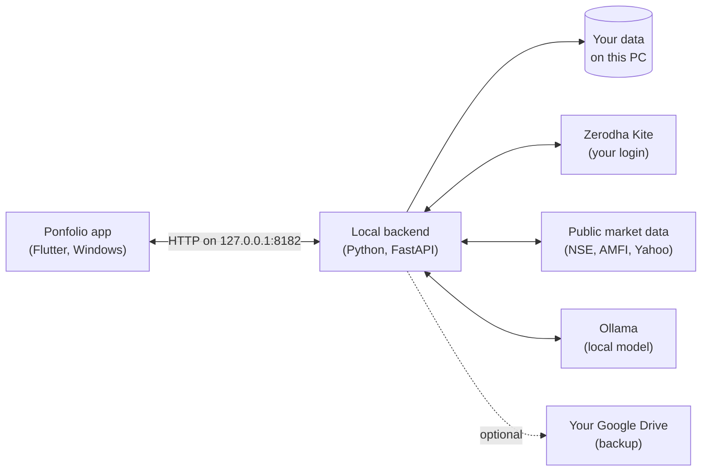

<div align="center">

# Ponfolio

**A local-first wealth terminal for Indian markets.**

*Pon* (பொன், Tamil for gold) + port*folio*.


[**Download for Windows**](https://github.com/mano066/Ponfolio/releases/latest) ·
[Features](#features) · [Getting started](#getting-started) ·
[How it works](#how-it-works) · [Build from source](#build-from-source)

</div>

---

Ponfolio brings your Indian stocks, mutual funds, SIPs and cash flow into one
desktop app, and adds the analysis a serious investor wants: swing-trade
setups, technical signals, allocation and rebalancing, and research you can
verify. It runs entirely on your computer. Your broker session, holdings and
history stay on your machine, and the AI runs on a local model.

## Features

| | |
|---|---|
| **Portfolio analytics** | Live holdings, P&L, XIRR and allocation with Zerodha Kite sync. Import tradebook, P&L and ledger exports for closed positions, charges and TDS. |
| **Mutual funds and SIP** | Track your MF portfolio, screen funds, and model SIPs with a built-in simulator to see long-term outcomes. |
| **Swing scanner** | Scans the Nifty Total Market for setups with buy zones, stop-loss, targets, risk:reward and a plain-English reason for each. |
| **Market signals** | Trend, momentum, volume and volatility signals, with a transparent 0-100 strength score. |
| **Allocation and rebalancing** | See exposure by sector and asset class, and get a rebalancing plan that respects tax (resident or NRI) and your bands. |
| **Deep analysis** | A multi-agent analysis of any stock, run on a local LLM through [Ollama](https://ollama.com). |
| **Wealth and expenses** | Multi-currency cash-flow tracking: income, expenses, savings rate and closing balances. |
| **Research library** | Built-in studies with their data and method, for example [fixed SIP vs value averaging on the Nifty 50 since 1996](docs/reports/smart-sip/). |

## Private by design

- **Local-first.** The app and its backend run on your PC. There is no Ponfolio
  server, and you can use the app as a guest without any account.
- **Your broker, your login.** Zerodha sign-in uses Zerodha's own Kite login in
  your browser; Ponfolio never sees your password.
- **Local AI.** Analysis runs on a model on your machine via Ollama, not a
  cloud API.
- **Optional backup.** Google Drive backup is off unless you sign in with
  Google, and then uses a private app folder in your own Drive.

## Getting started

### Install

1. Download `Ponfolio_Setup_v<version>.exe` from
   [Releases](https://github.com/mano066/Ponfolio/releases/latest).
2. Run it. Windows SmartScreen may warn that the publisher is unknown, because
   the installer is not code-signed yet: choose **More info → Run anyway**.
3. Launch **Ponfolio** from the Start menu.

The installer is self-contained: it includes its own Python runtime, so you do
not need Python installed.

**Requirements:** Windows 10 or 11 (64-bit), about 300 MB of disk space, and an
internet connection for market data.

### First run

- **Continue as guest** on the welcome screen, or sign in with Google to enable
  Drive backup.
- **Connect Zerodha** (optional): click **Connect Zerodha** in the sidebar and
  sign in to Kite. Without it you can still add holdings manually.
- **Enable AI analysis** (optional): install [Ollama](https://ollama.com), pull a
  model (for example `ollama pull llama3.2`), and select it in Settings.
  Everything else works without it.
- **Add your mutual funds** and SIPs from the Mutual Funds screen.

## How it works



The installer ships the Flutter app and a bundled Python runtime with the
backend. The app starts the backend when it opens and stops it when it closes.

## Build from source

Requirements: Windows 10/11, [Flutter](https://docs.flutter.dev/get-started/install/windows)
(Dart 3.11+) with Visual Studio's C++ desktop workload, and Python 3.12.

```powershell
git clone https://github.com/mano066/Ponfolio.git
cd Ponfolio
git config core.hooksPath tools/git-hooks   # blocks committing secrets or personal data

# Backend
cd backend
python -m venv .venv; .\.venv\Scripts\Activate.ps1
pip install -r requirements.txt
copy .env.example .env    # optional: Kite Connect API key and secret
python main.py            # http://127.0.0.1:8182

# App (new terminal, repository root)
flutter pub get
flutter run -d windows
```

**Tests:** `flutter test` for the app, and
`cd backend; python -m unittest discover -p "test_*.py"` for the backend.

**Installer:** `flutter build windows --release`, put an embeddable Python
3.12 with the backend requirements in `installer/python-embed/`, then compile
`installer.iss` with [Inno Setup 6](https://jrsoftware.org/isinfo.php).

**Google sign-in** needs your own OAuth client: set `GOOGLE_CLIENT_ID` and
`GOOGLE_CLIENT_SECRET`, or create `backend/google_oauth.json`
(`{"client_id": "...", "client_secret": "..."}`). Both are git-ignored.

## Project layout

| Path | Contents |
|---|---|
| [`lib/`](lib), [`test/`](test), [`windows/`](windows), [`assets/`](assets) | Flutter desktop app |
| [`backend/`](backend) | Python API server and its tests |
| [`dataset/`](dataset) | NSE daily and intraday data pipeline |
| [`research/`](research) | Studies: write-ups, scripts and results |
| [`docs/`](docs) | Documentation and published research reports |
| [`site/`](site) | Product web page |
| [`tools/`](tools) | Developer helpers and git hooks |

## Security and privacy

Found a vulnerability? Please report it privately through
**Security → Report a vulnerability** on this repository. See
[SECURITY.md](SECURITY.md) for what this project never commits.

## License

Source available, all rights reserved. You may read the code; reuse or
redistribution needs written permission. See [LICENSE](LICENSE).

## Disclaimer

Ponfolio is a research and analysis tool, not investment advice, and its
author is not a SEBI-registered adviser. Signals, scores and backtests are
based on past data and do not predict future returns. Investing in securities
involves risk, including loss of capital. Decide for yourself, or consult a
registered adviser.
